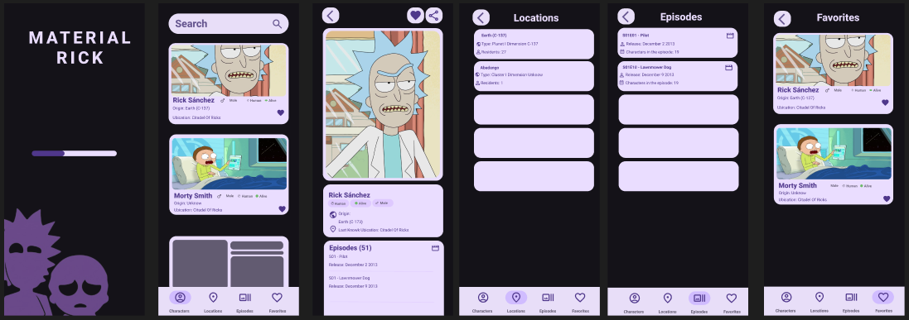
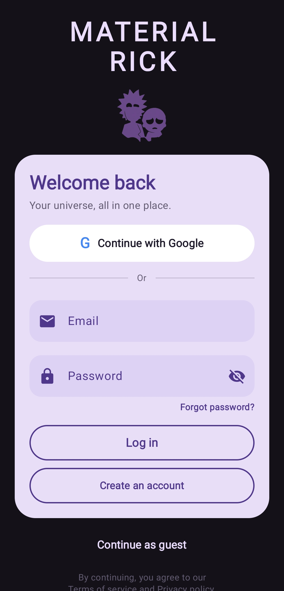
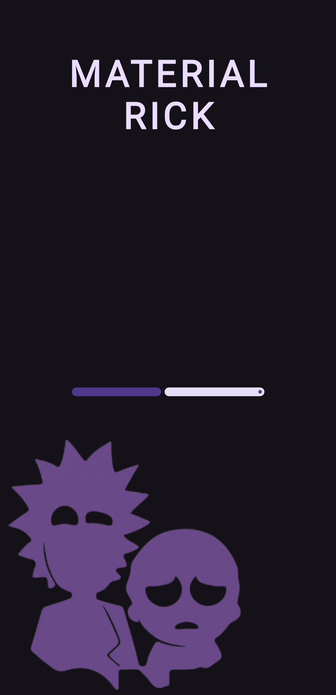
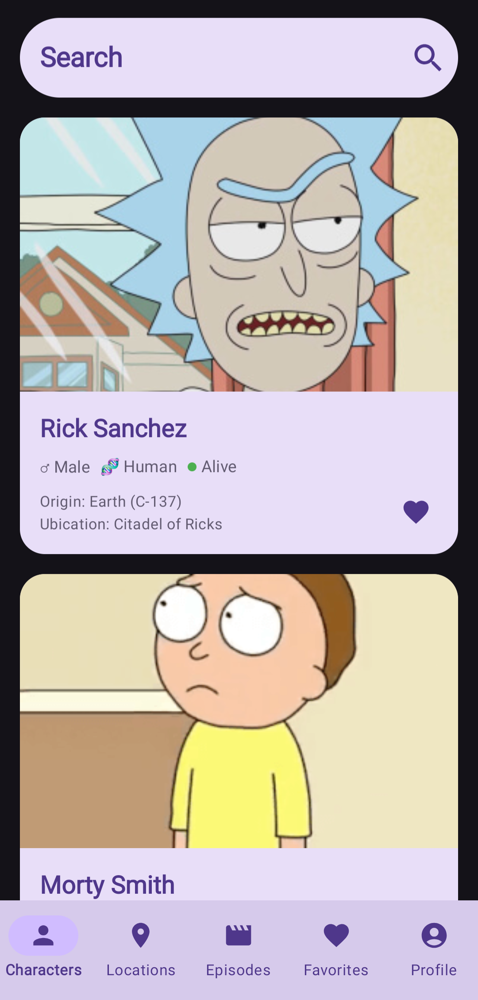
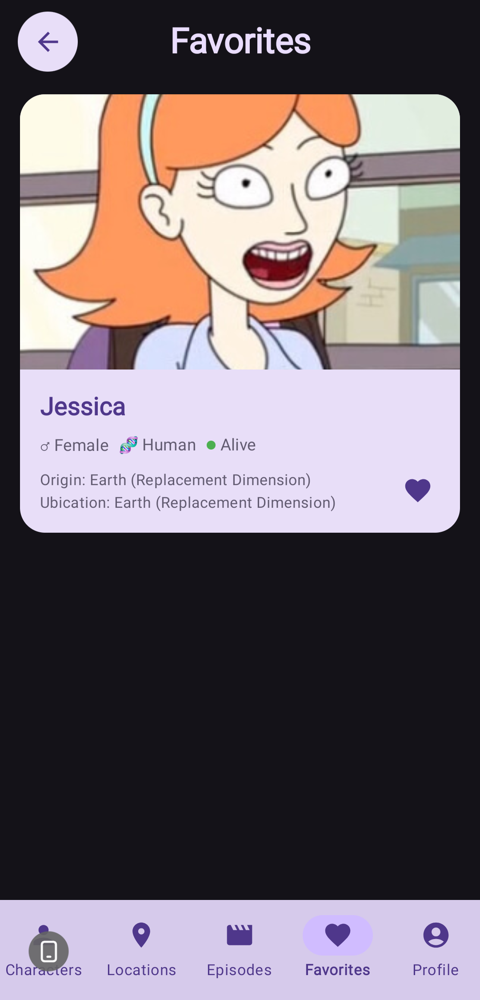
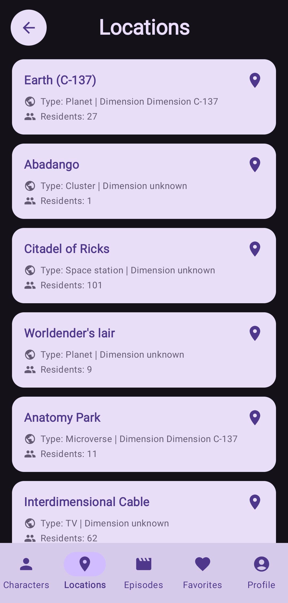
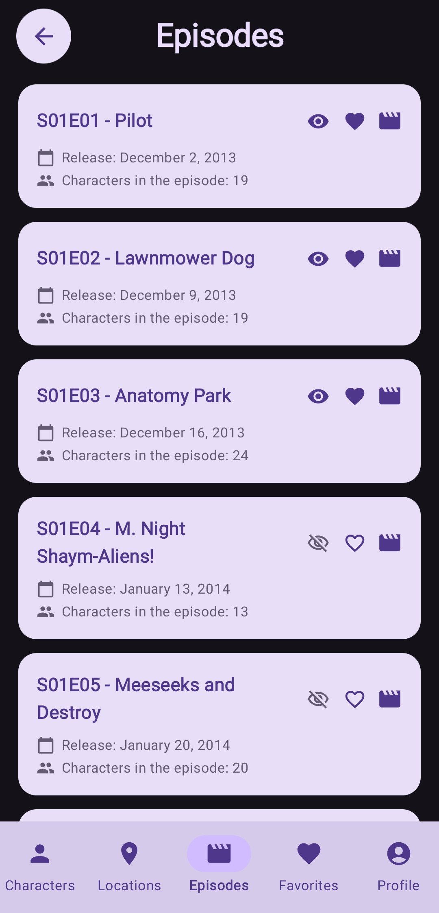
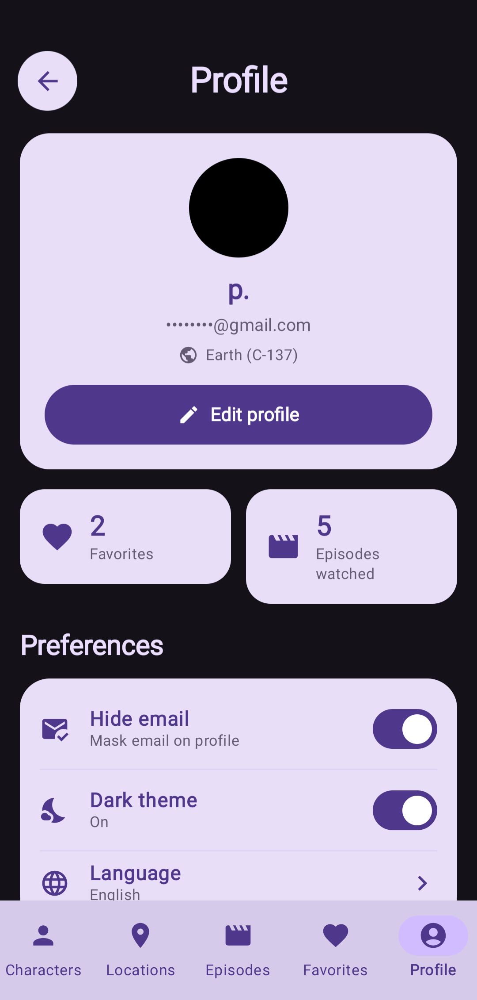

# Material Rick & Morty

Aplicación Android para explorar personajes, episodios y ubicaciones del universo de **Rick and Morty**. Permite guardar favoritos y episodios vistos en un perfil de Firebase cuando se inicia sesión.

## Contenido

- [Funcionalidades](#funcionalidades)
- [Tecnologías](#tecnologías)
- [Cómo está organizado](#cómo-está-organizado)
- [Datos y Firebase](#datos-y-firebase)
- [Requisitos y ejecución](#requisitos-y-ejecución)
- [Diseño en Figma](#diseño-en-figma)
- [Capturas de la app](#capturas-de-la-app)

## Funcionalidades

- Explorar personajes con búsqueda por nombre y carga paginada.
- Consultar el detalle de un personaje, sus datos y episodios relacionados.
- Explorar ubicaciones y episodios.
- Marcar personajes y episodios como favoritos, y episodios como vistos.
- Crear una cuenta o iniciar sesión con correo y contraseña.
- Iniciar sesión con Google mediante Android Credential Manager y Firebase Authentication.
- Continuar como invitado. Las acciones que necesitan guardar datos piden iniciar sesión.
- Ver y editar el nombre del perfil, ocultar el correo en la pantalla de perfil y cerrar sesión.

La pantalla de perfil muestra el tema oscuro como activo y el idioma configurado. El selector de idioma todavía no está conectado a una acción de cambio.

## Tecnologías

- **Kotlin** y **Jetpack Compose** con Material 3.
- **Navigation Compose** para navegar entre carga, autenticación, catálogo y detalle.
- **ViewModel**, `StateFlow` y corrutinas para estado y operaciones asíncronas.
- **Retrofit**, Gson y OkHttp para consumir la [API de Rick and Morty](https://rickandmortyapi.com/documentation).
- **Coil** para cargar imágenes.
- **Firebase Authentication** para cuentas de correo/contraseña y credenciales de Google.
- **Cloud Firestore** para persistir perfiles, favoritos, preferencias y episodios vistos.

## Cómo está organizado

El código de la app está dentro de `app/src/main/java/com/example/materialrickandmorty/`:

```text
data/
├── api/          Cliente Retrofit y endpoints de Rick and Morty
├── auth/         Integración de Google Credential Manager
├── model/        Modelos de personajes, episodios, ubicaciones y perfil
└── repository/   Acceso a la API, Firebase Authentication y Firestore
ui/
├── navigation/   Rutas y navegación Compose
├── screens/      Pantallas de autenticación, catálogo, detalle y perfil
├── theme/        Colores, tipografía y tema Material 3
└── viewmodel/    Estado de pantalla y coordinación entre repositorios
MainActivity.kt   Punto de entrada de la aplicación
```

La interfaz observa el estado expuesto por `RickAndMortyViewModel`. El ViewModel delega las llamadas de red a `RickAndMortyRepository`, el acceso a cuentas a `AuthRepository` y los datos persistentes del usuario a `FirestoreRepository`.

## Datos y Firebase

La app se configura con el proyecto Firebase indicado por `.firebaserc` (`rickandmorty777`). El archivo `app/google-services.json` es necesario para compilar y ejecutar la integración, pero se mantiene fuera de Git por `app/.gitignore`; cada entorno debe obtener su configuración desde Firebase Console.

### Autenticación

Habilita **Email/Password** y **Google** en Firebase Console → Authentication → Sign-in method. Google Sign-In necesita además que la huella SHA-1 del certificado de firma esté asociada a la app Android registrada con el paquete `com.example.materialrickandmorty`.

Para consultar la firma debug de tu máquina:

```powershell
.\gradlew.bat signingReport
```

Registra la SHA-1 correspondiente en Firebase Console → Project settings → Your apps → Android app. La SHA-1 debug del entorno de desarrollo actual ya está registrada; otros equipos y la firma de publicación pueden requerir huellas distintas.

### Firestore

El perfil se guarda en el documento `users/{uid}`. Incluye nombre, correo, URL de foto, personajes favoritos, episodios favoritos, episodios vistos y preferencias. Las reglas de `firestore.rules` limitan el acceso al usuario autenticado cuyo UID coincide con el ID del documento y rechazan las demás rutas.

Para publicar las reglas con Firebase CLI:

```powershell
firebase login
firebase deploy --only firestore:rules --project rickandmorty777
```

Si modificas las reglas, comprueba sus permisos antes de distribuir la app. No abras la colección de perfiles a todos los usuarios: contiene datos personales.

## Requisitos y ejecución

- Android Studio con soporte para Kotlin y Jetpack Compose.
- JDK 11 para la compilación configurada en Gradle.
- Android SDK con `compileSdk 37`; la app admite desde `minSdk 24`.
- `app/google-services.json` válido para el proyecto Firebase.
- Conexión a Internet para Firebase y la API pública de Rick and Morty.

Abre el proyecto en Android Studio y ejecútalo en un emulador o dispositivo. Desde PowerShell también puedes compilar e instalar la variante debug:

```powershell
.\gradlew.bat :app:assembleDebug
.\gradlew.bat :app:installDebug
```

## Diseño en Figma



## Capturas de la app

| Inicio de sesión | Pantalla 0 | Pantalla 1 |
|:---:|:---:|:---:|
|  |  |  |
| Pantalla 2 | Pantalla 3 | Pantalla 4 |
|  |  |  |
| Pantalla 5 |  |  |
|  |  |  |
